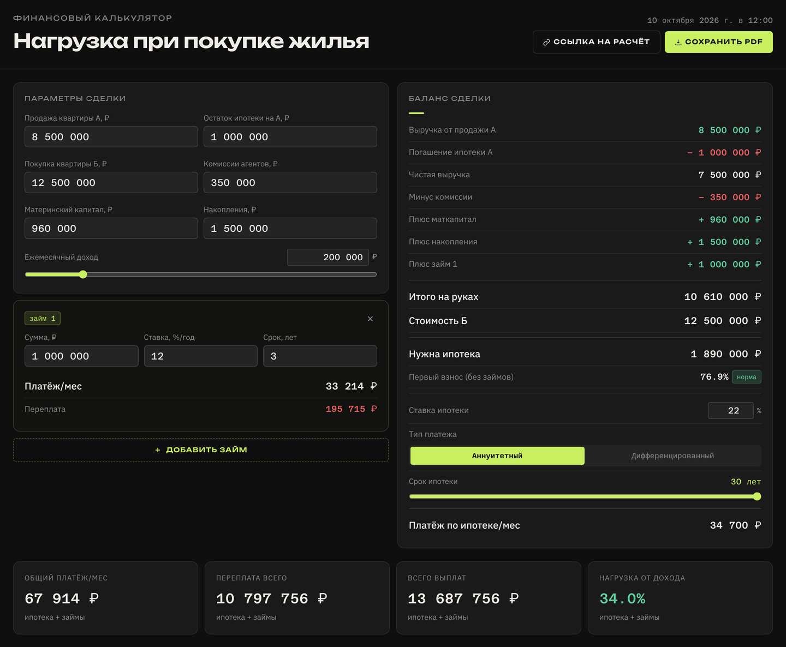

# Mortgage Calculator

**Sell one flat, buy another: how big a mortgage you need and how much of your income it will take.** Most mortgage calculators start from a loan amount. This one starts from the deal itself. You enter the sale of your current flat, what's left on its mortgage, agent fees, maternity capital, savings and any extra loans. It works out the gap that a new mortgage has to cover, then shows the monthly payment and the share of your income it takes.

> 🇷🇺 Калькулятор финансовой нагрузки при обмене жилья: продаём квартиру А → покупаем Б → сколько ипотеки нужно, какой будет платёж и какая доля дохода на него уйдёт.

**[Open the calculator →](https://oz-the-magician.github.io/mortgage-calculator/)**



## What it does

| Block | What you get |
|---|---|
| **Deal balance** | Line-by-line flow of money: sale proceeds, mortgage payoff, fees, maternity capital, savings and loans add up to the cash on hand, which is compared with the price of the new flat. Shows either the mortgage needed or the cash left over |
| **Down payment** | Share of the price covered by your own money, with a warning below 20%. Extra loans are excluded, since they are debt too |
| **Mortgage** | Rate, term (1–30 years), annuity or differentiated payments. For differentiated payments it shows the first and last payment |
| **Extra loans** | Any number of consumer loans to close the gap, each with its own rate, term, payment and annuity schedule |
| **Load summary** | Total monthly payment, total overpayment and total paid, plus the payment as a share of income: green up to 35%, amber up to 50%, red above that |
| **Amortization** | Year-by-year schedule for the mortgage (5 years / 10 years / full term) and for each loan |
| **Shareable link** | Every input is stored in the page URL, so one link reopens exactly the same calculation |
| **PDF export** | Prints to a clean, light A4 layout with selectable text |

Everything recalculates as you type. Large amounts are typed with thousands separators, and income can be entered exactly or set with the slider. The layout works on phones and is keyboard-accessible. Amounts are in roubles, and the interface is in Russian.

## Run locally

It's a static page with no build step and no dependencies to install. Just open `index.html` in a browser.

```
index.html   — markup
style.css    — styles, including the mobile and print layouts
calc.js      — calculations, UI and URL state
```

## Stack

Vanilla HTML, CSS and JavaScript, with no libraries. PDF export uses the browser's own print dialog. Fonts are Unbounded, IBM Plex Sans and Azeret Mono from Google Fonts.

## Disclaimer

The results are estimates. Banks apply their own rules for down payments, insurance and income checks, so treat this as a planning tool, not an offer.

## License

[MIT](LICENSE)
